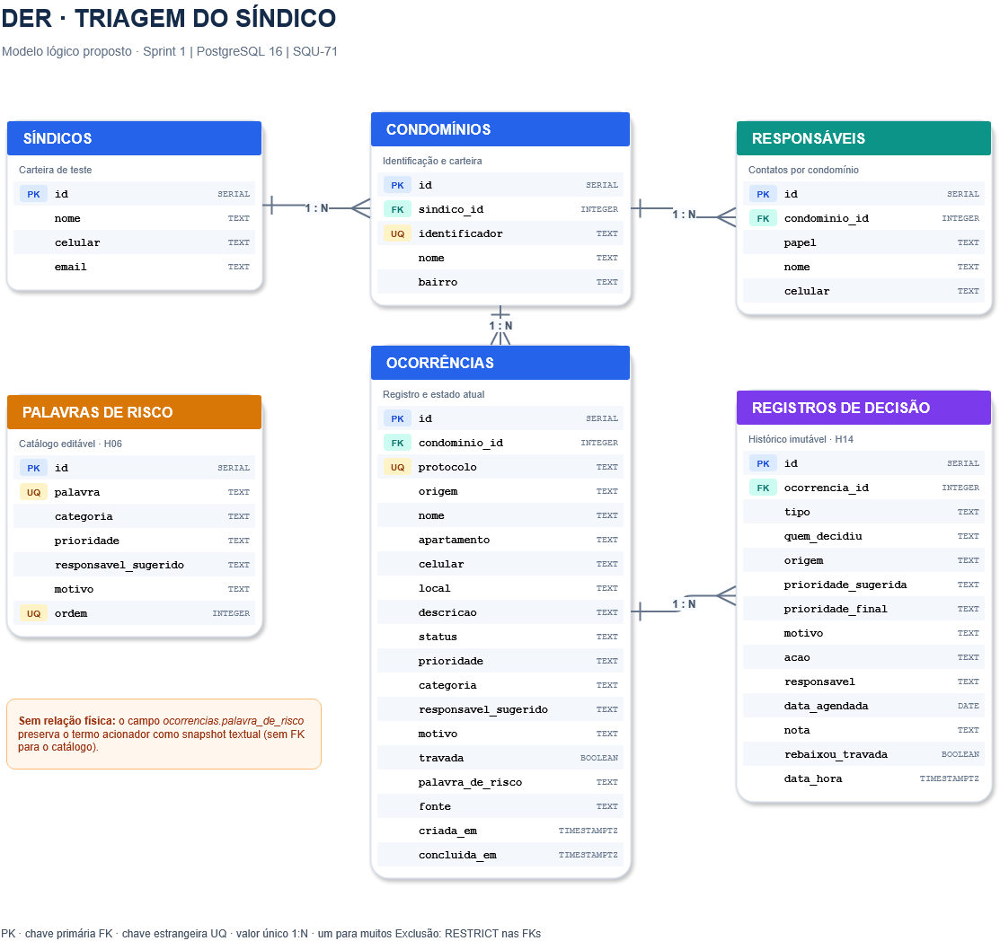

# DER — Banco de dados da Sprint 1

**Projeto:** Triagem do Síndico — Squad 03  
**Tarefa:** [SQU-71](https://linear.app/squad03/issue/SQU-71)  
**Estado:** Modelo proposto; implementação por migration na SQU-72.  
**Dicionário de dados:** [modelagem-sprint-1.md](modelagem-sprint-1.md)

## Diagrama Entidade-Relacionamento

O diagrama abaixo apresenta a estrutura do banco de dados da Sprint 1 do projeto **Triagem do Síndico**, incluindo as entidades, seus atributos, chaves primárias (PK), chaves estrangeiras (FK) e relacionamentos.

**Arquivo editável:** [Abrir diagrama no draw.io](./der-sprint-1.drawio)

O modelo contempla seis entidades: `sindicos`, `condominios`, `responsaveis`, `ocorrencias`, `registros_decisao` e `palavras_risco`. As definições detalhadas dos campos, restrições e decisões de normalização estão disponíveis em [Modelagem do banco de dados](./modelagem-sprint-1.md).

## Leitura do modelo

- **Síndico 1:N Condomínios:** cada condomínio tem um síndico da carteira; a síndica de teste administra três condomínios. Não há login.
- **Condomínio 1:N Responsáveis:** contatos por papel (`zelador` e `portaria`) são específicos de cada condomínio.
- **Condomínio 1:N Ocorrências:** o ID do condomínio é a referência de segregação da fila e do formulário.
- **Ocorrência 1:N Registros de decisão:** histórico cronológico append-only; nunca apagar em cascata.
- **Palavras de risco:** tabela independente. A ocorrência guarda um *snapshot* textual de `palavra_de_risco`, sem FK física, para preservar a evidência após edição da lista.

**Convenções:** `int` indica `SERIAL` para PKs e `INTEGER` para FKs; `UK` significa coluna UNIQUE. O Mermaid mostra a estrutura lógica, não substitui constraints, trigger e índices descritos em `modelagem-sprint-1.md`.

## Conferência antes da migration

- [ ] Verificar se os colegas aprovaram a nova FK `condominios.sindico_id` e o ajuste das fixtures de testes.
- [ ] Conferir os papéis/contatos do PO e a unicidade de `(condominio_id, papel)`.
- [ ] Preservar todas as colunas que `salvar_ocorrencia.py`, `registrar_decisao.py` e `concluir_ocorrencia.py` já utilizam.
- [ ] Tratar a prioridade efetiva da fila e a atualização do status após a ação no fluxo apropriado.
- [ ] Incorporar a imutabilidade de `registros_decisao` sem apagar histórico por cascata.
